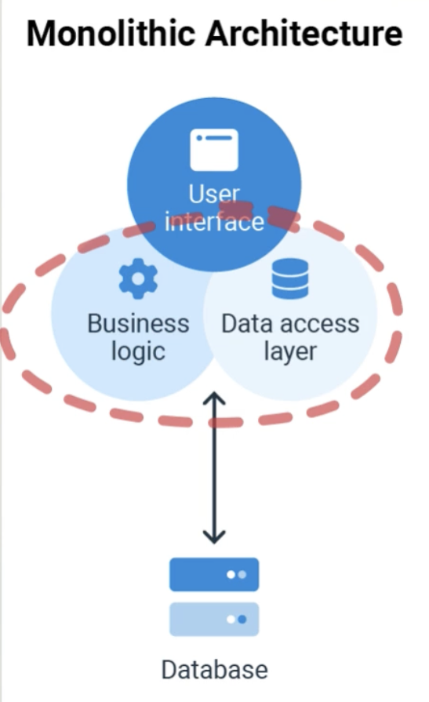
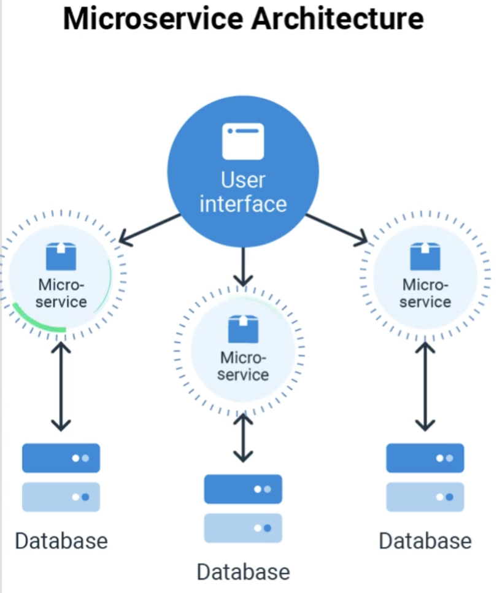
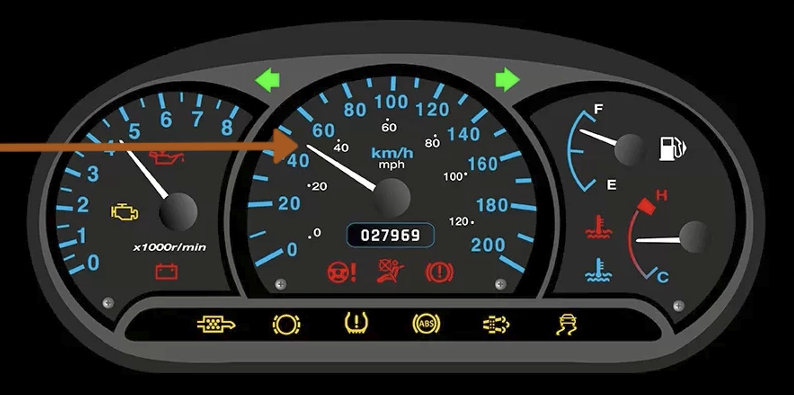
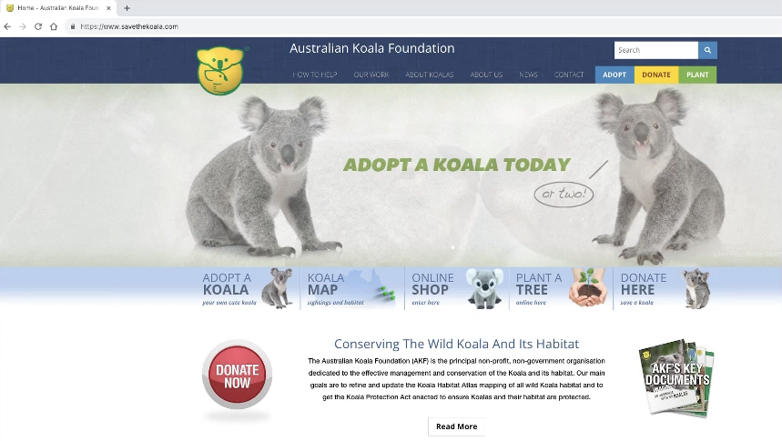
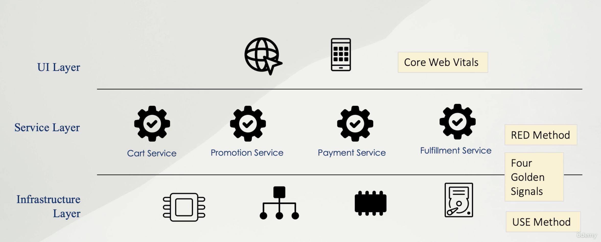

# 🔭 Foundations of Observability

A practical reference guide for learning observability from scratch — covering why modern architectures need it, monitoring vs observability, telemetry data (MELT), monitoring methods, metric collection, and how teams measure incident response.

---

## 📋 Table of Contents

- [Introduction](#-introduction)
  - [Who Is This For?](#who-is-this-for)
  - [What This Material Covers](#what-this-material-covers)
  - [Why Learn Observability?](#why-learn-observability)
- [From Monolith to Microservices](#️-from-monolith-to-microservices)
  - [Monolithic Architecture](#monolithic-architecture)
  - [Microservice Architecture](#microservice-architecture)
  - [Waterfall vs CI/CD](#waterfall-vs-cicd)
  - [Why Modern Systems Need Observability](#why-modern-systems-need-observability)
- [Monitoring](#-monitoring)
  - [What Is Monitoring?](#what-is-monitoring)
  - [The 3 Key Questions](#the-3-key-questions)
  - [Example: Car Dashboard](#example-car-dashboard)
  - [Example: Save the Koala Website](#example-save-the-koala-website)
- [Observability](#-observability)
  - [What Is Observability?](#what-is-observability)
  - [Problems with Monitoring Alone](#problems-with-monitoring-alone)
  - [Monitoring vs Observability](#monitoring-vs-observability)
- [Telemetry Data (MELT)](#-telemetry-data-melt)
  - [What Is MELT?](#what-is-melt)
  - [Event](#event)
  - [Metric](#metric)
  - [Log](#log)
  - [Trace](#trace)
  - [MELT Compared](#melt-compared)
- [Monitoring Methods](#-monitoring-methods)
  - [Choosing a Method by Layer](#choosing-a-method-by-layer)
  - [RED Method](#red-method)
  - [USE Method](#use-method)
  - [Four Golden Signals](#four-golden-signals)
  - [Core Web Vitals](#core-web-vitals)
- [Metric Collection](#-metric-collection)
  - [Push Method](#push-method)
  - [Scrape Method](#scrape-method)
  - [Choosing Push or Scrape](#choosing-push-or-scrape)
  - [Push vs Scrape](#push-vs-scrape)
- [MTTD & MTTR](#️-mttd--mttr)
  - [Mean Time to Detection (MTTD)](#mean-time-to-detection-mttd)
  - [Mean Time to Resolve (MTTR)](#mean-time-to-resolve-mttr)
  - [Example: Incident Timeline](#example-incident-timeline)
- [Quick Reference](#-quick-reference)
- [Best Practices](#-best-practices)

---

## 🎯 Introduction

### Who Is This For?

- **Backend Programmer** — Learns how to make services report their own health
- **DevOps / SRE Engineer** — Learns how to detect, investigate, and resolve incidents faster
- **Software Architect** — Understands which signals a distributed system must expose
- **Web Programmer** — Understands how user-facing performance is measured

### What This Material Covers

- Theory and concepts behind monitoring and observability
- Real-world analogies and examples
- Not tied to any specific tool — Prometheus is covered in [002 — Prometheus](002-prometheus.md)

### Why Learn Observability?

- **Microservices are the norm** — More services means more places for things to break
- **Faster recovery** — Good telemetry shortens the time to find and fix problems
- **Unknown failures** — Distributed systems fail in ways nobody predicted upfront
- **Career growth** — Core knowledge for DevOps, SRE, and Senior Engineers

---

## 🏛️ From Monolith to Microservices

> **Analogy:** A monolith is a giant layered cake — if the bottom layer is burnt, you can't replace just that layer, you bake the whole cake again. Microservices are LEGO bricks — if one brick breaks, you pull it out and snap in a new one without taking the whole building apart.

### Monolithic Architecture



- All parts of the application — **UI, business logic, and data access** — are combined into one large application
- Changing one small feature means **redeploying the entire application**

### Microservice Architecture



- The application is split into **small, independent services** (login, payment, cart)
- Each service has **its own database**
- Teams can work on different services **at the same time**

### Waterfall vs CI/CD

| | Waterfall | CI/CD |
| --- | --- | --- |
| Fits with | Monolith | Microservices |
| Analogy | Building a house from scratch — design, foundation, walls, and roof must be 100% done before anyone moves in | A coffee shop that keeps innovating — brew a new drink, sell it, collect feedback, improve it tomorrow |
| Rhythm | Big and infrequent | Small, frequent, and fast |

### Why Modern Systems Need Observability

Modern architecture is like a very busy city:

- **Many services to watch** — Like hundreds of shops in one city
- **Communication between services can break** — Couriers between services get lost or stuck
- **More exposed to attacks** — Many entrances to guard
- **Code changes constantly** — Renovations every day, so the risk of new errors is higher

> **Key Insight:** Microservices and CI/CD make change cheap — but every change is also a new chance to break something you can't see from one place.

---

## 📈 Monitoring

> **Analogy:** A doctor's routine check-up. The doctor doesn't wait until you collapse — they take regular lab tests (blood pressure, heart rate) to spot illness early. Those lab results are the system's **telemetry data**.

### What Is Monitoring?

- The routine activity of **collecting and watching system health data**
- The data being collected is called **telemetry data**
- You decide **upfront** what to watch and what counts as unhealthy

### The 3 Key Questions

- **Is it up?** — Is the service running at all?
- **Is it doing its job?** — Is it fulfilling its purpose?
- **Is it working well?** — Is it fast and healthy?

### Example: Car Dashboard



| Question | Indicator in the Car |
| --- | --- |
| Is it up? | RPM needle above 0 — the engine is running |
| Is it doing its job? | Car moving at 50 km/h — its main purpose is fulfilled |
| Is it working well? | Not necessarily — the *Check Engine* light is on, a hidden problem exists even though the car still moves |

### Example: Save the Koala Website



| Question | How to Check |
| --- | --- |
| Is it up? | Send an HTTP `GET`/`HEAD` — a `200 OK` reply means the website is up |
| Is it doing its job? | Count errors in the logs (e.g. Python errors) — below a threshold (e.g. < 5 errors/minute) means normal |
| Is it working well? | Measure response time — under 20 ms means excellent performance |

---

## 🔭 Observability

> **Analogy:** Monitoring is the **fuel warning light** — it tells you one thing you decided to watch in advance: *"your fuel is low."* Observability is a **workshop with a full diagnostic computer** — when the car breaks down mysteriously, the mechanic traces electricity, fuel pressure, and engine temperature at once to find *why* and *where* it failed, even for problems never seen before.

### What Is Observability?

- The ability to **understand a system's internal state** purely from the data it produces (telemetry)
- Combines **metrics, logs, and traces** into one holistic view of the system
- Helps answer questions you **didn't know you'd need to ask** — the *unknown unknowns*

### Problems with Monitoring Alone

- **Blind to what you didn't plan for** — A component you forgot to watch gives no signal when it breaks
- **Tool sprawl** — Adding manual rules and tools one by one leads to many disconnected dashboards
- **Tells you *when*, not *why*** — An alert fires, but finding the root cause still takes manual digging

### Monitoring vs Observability

| | Monitoring | Observability |
| --- | --- | --- |
| Focus | *What* and *when* | *Why* and *where* |
| How it works | Decide upfront what to watch (e.g. CPU limit 80%) | Collect metrics, logs, and traces broadly and correlate them |
| Handles | Known failures | Unknown unknowns |
| Best for | Monoliths with predictable failure points | Distributed systems such as microservices |

> **Note:** Observability doesn't replace monitoring — it builds on it. You still need alerts; observability is what you use after the alert fires.

---

## 📦 Telemetry Data (MELT)

> **Analogy:** A store selling a bag of chips. The **receipt** proves a sale happened (event). The **daily sales chart** summarizes all sales (metric). The **detailed transaction record** tells the full story of one sale (log). The **order tracking** follows one online order from payment to kitchen to delivery (trace).

### What Is MELT?

- **MELT** stands for the 4 main types of telemetry data: **Metric, Event, Log, Trace**
- Each type answers a different question about the system

### Event

- A record that **one specific action happened at a specific time**
- Proves an expected action really occurred (button clicked, data saved)
- Commonly found in platforms like **Kafka**
- Example: *"1 bag of chips bought at 15:20"*

### Metric

- **Aggregated numbers** summarizing many events over a period of time
- Great for **trends** and comparing performance against the past
- Example: *"On average 100 bags sold per minute today"* or *"CPU climbed to 80% at noon"*

### Log

- A **detailed text record** of an event together with its context
- The main **evidence** when investigating an error

```text
Item         : Potato Chips
Price        : Rp10,000
Time         : 15:20:05.123 WIB
Cashier ID   : VEND-SURABAYA-04
Payment      : QRIS
Status       : Success (200)
```

### Trace

- Records **one request's journey across services** from start to finish
- Shows **which service** makes the process slow or fail

```text
Tap "Pay"
  ↓
API Gateway            (10 ms)
  ↓
Payment Service        (200 ms)
  ↓
Inventory Service      (50 ms)
  ↓
Notification Service
```

If the flow stalls for 5 seconds, the trace points straight at the slow service.

### MELT Compared

| Type | Question Answered | Analogy |
| --- | --- | --- |
| **Metric** | What is the trend? | Daily sales chart |
| **Event** | What happened? | Purchase receipt |
| **Log** | What are the details? | Detailed transaction record |
| **Trace** | Where is it slow or failing? | Order tracking |

---

## 🧭 Monitoring Methods

> **Analogy:** A restaurant inspector doesn't check everything the same way. At the cashier, they watch customers and waiting times. In the kitchen, they check how busy the cooks and stoves are. At the entrance, they watch a guest's first impression. Each layer of a system has its own checklist.

### Choosing a Method by Layer



| Layer | Method |
| --- | --- |
| **UI Layer** | Core Web Vitals |
| **Service Layer** | RED Method, Four Golden Signals |
| **Infrastructure Layer** | USE Method, Four Golden Signals |

### RED Method

Focus on **services** — like watching the cashier at a fast-food restaurant.

- **Rate** — How many customers arrive per minute? *(requests per second)*
- **Errors** — How many orders fail or are wrong? *(e.g. HTTP 500)*
- **Duration** — How long do customers wait? *(response time / latency)*

### USE Method

Focus on **infrastructure** — like checking the cooks and kitchen equipment.

- **Utilization** — How busy are the cooks and stoves? *(e.g. CPU 85%, disk 90%)*
- **Saturation** — How long is the pile of unprocessed orders? *(CPU/network queue; 0 means smooth)*
- **Errors** — Is any equipment broken? *(e.g. failed disk writes)*

### Four Golden Signals

The **Google SRE** standard — the four most vital signals to watch.

- **Latency** — How long do users wait?
- **Traffic** — How much demand is coming in?
- **Errors** — How often does the system fail?
- **Saturation** — How close is the system to its maximum capacity?

### Core Web Vitals

Focus on **web user experience** — like a guest's first impression when entering a store.

- **LCP (Largest Contentful Paint)** — How fast does the main display become visible?
- **FID (First Input Delay)** — When the guest rings the bell, how fast does staff respond?
- **CLS (Cumulative Layout Shift)** — Do the shelves suddenly move while the guest is walking?

> **Note:** Since March 2024, Google replaced **FID** with **INP (Interaction to Next Paint)**, which measures responsiveness to *all* interactions, not just the first one.

---

## 📥 Metric Collection

> **Analogy:** There are two ways a boss can get reports. Either every employee emails their report each evening (**push**), or the boss walks desk to desk at set times to collect them (**scrape**).

### Push Method

- The application **actively sends** metrics to a central server over TCP, UDP, or HTTP
- Example: an app sends metrics to **StatsD**, which stores them in **Graphite**

### Scrape Method

- The application **exposes an endpoint** (usually `/metrics`)
- The monitoring server **visits periodically** to pull the data
- Example: **Prometheus** scrapes an application's metrics endpoint

### Choosing Push or Scrape

**1. Type of System**

- **Scrape** — Like a permanent employee at a fixed desk; the boss can visit anytime. Suits **long-running services** with a clear address
- **Push** — Like an express courier who finishes and goes home with the phone off; they must report before leaving. Suits **short-lived** jobs such as *serverless functions* and *batch jobs*

**2. Scalability**

- **Scrape** — Like a census officer going door to door; 10 houses is easy, 10,000 is overwhelming. The burden sits on the central server
- **Push** — Like 10,000 family members messaging Dad's phone in the same second; the central server gets a *traffic jam*

**3. Detecting a Dead Service**

- **Scrape** — Like a teacher taking attendance; when Budi doesn't answer, the teacher **knows immediately**. A failed scrape means the service is down
- **Push** — Like waiting for permission slips; if Budi collapses on the way, the teacher never hears about it. Push needs a **heartbeat** to tell "dead" from "just late"

> **Gotcha:** With push, the application must know the central server's address, and metrics sent while the network is down are simply lost.

### Push vs Scrape

| | Scrape | Push |
| --- | --- | --- |
| Who starts the transfer | Monitoring server | Application |
| Best for | Long-running services | Short-lived jobs |
| Scalability burden | On the monitoring server | Traffic spikes at the central server |
| Detecting dead services | Immediate | Needs a heartbeat |
| Example | Prometheus | StatsD + Graphite |

---

## ⏱️ MTTD & MTTR

> **Analogy:** A kitchen fire. **MTTD** is how long the smoke spreads before the alarm wakes anyone up. **MTTR** is how long it takes from waking up until the fire is out and the kitchen is safe again.

### Mean Time to Detection (MTTD)

- The average time from when the system **starts failing** until the team **notices**
- Lower is better — good monitoring and alerting shrink it

### Mean Time to Resolve (MTTR)

- The average time from when a problem is **detected** until the system is **back to normal**
- Lower is better — good observability shrinks it, because finding the root cause is faster

### Example: Incident Timeline

| Time | Event |
| --- | --- |
| 14:00 | Payment feature errors out because of a database problem |
| 14:15 | Monitoring system sends an *alert* to the team |
| 14:45 | Database fixed, payments back to normal |

- **MTTD = 15 minutes** (14:00 → 14:15)
- **MTTR = 30 minutes** (14:15 → 14:45)

> **Note:** A team's MTTD and MTTR are averages across all incidents in a period (e.g. one month).

---

## 🎯 Quick Reference

| Concept | Problem Solved | Key Trade-off |
| --- | --- | --- |
| **Monitoring** | Detects known failures early | Blind to what wasn't planned for |
| **Observability** | Explains *why* and *where* unknown failures happen | More data to collect, store, and correlate |
| **Metric** | Cheap trend and alerting data | Loses per-request detail |
| **Event** | Proves an action happened | No aggregated view on its own |
| **Log** | Rich detail for investigation | Expensive to store and search at scale |
| **Trace** | Pinpoints the slow service in a request chain | Requires instrumenting every service |
| **RED Method** | Measures service health from the user's side | Doesn't show resource exhaustion |
| **USE Method** | Measures infrastructure health | Doesn't show user-facing impact |
| **Four Golden Signals** | One checklist covering services and infrastructure | Still needs per-layer detail |
| **Core Web Vitals** | Measures real user experience in the browser | Frontend only |
| **Push** | Captures short-lived jobs | Harder to detect dead services |
| **Scrape** | Detects dead services immediately | Can't reach short-lived jobs |
| **MTTD / MTTR** | Measures how fast the team detects and recovers | Only meaningful as an average over many incidents |

---

## 💡 Best Practices

**✅ Do This**

- **Answer the 3 key questions for every service** — up, doing its job, working well
- **Use RED for services, USE for infrastructure** — and Core Web Vitals for the frontend
- **Collect all of MELT** — metrics for alerts, logs for detail, traces for cross-service flows
- **Prefer scrape for long-running services** — a failed scrape is a free health check
- **Use push only for short-lived jobs** — and pair it with a heartbeat
- **Track MTTD and MTTR over time** — they show whether your observability is actually improving

**❌ Avoid This**

- **Monitoring only what you expect to break** — the next outage is usually something you didn't expect
- **Adding a new tool for every problem** — tool sprawl makes correlation harder, not easier
- **Relying on logs alone in microservices** — without traces, you can't follow a request across services
- **Alerting on everything** — noisy alerts get ignored and raise MTTD

> Reference: [Google SRE Book — Monitoring Distributed Systems](https://sre.google/sre-book/monitoring-distributed-systems/) · [Brendan Gregg — The USE Method](https://www.brendangregg.com/usemethod.html) · [web.dev — Core Web Vitals](https://web.dev/articles/vitals)
