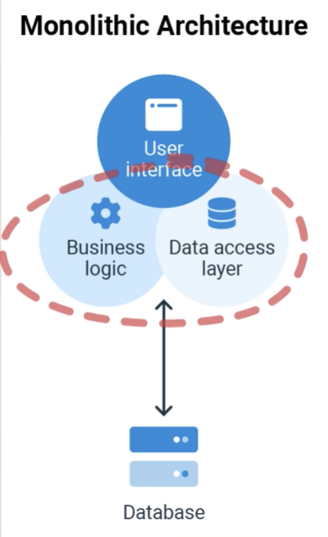
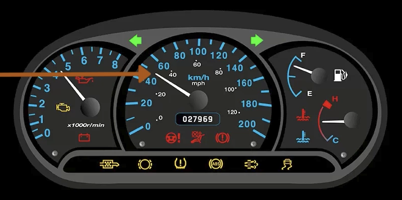
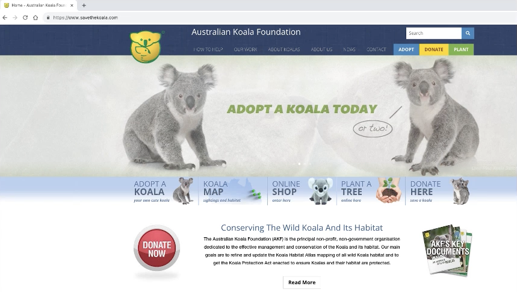

# 001 — Foundations of Observability

## Table of Contents

1. [Application Architecture & DevOps Evolution](#1-application-architecture--devops-evolution)
2. [Monitoring & the 3 Key Questions](#2-monitoring--the-3-key-questions)
3. [DevOps Success Metrics: MTTD & MTTR](#3-devops-success-metrics-mttd--mttr)
4. [Monitoring Methods](#4-monitoring-methods)
5. [Observability vs. Monitoring](#5-observability-vs-monitoring)
6. [Metric Collection: Push vs. Scrape](#6-metric-collection-push-vs-scrape)
7. [Types of Telemetry Data (MELT)](#7-types-of-telemetry-data-melt)

---

## 1. Application Architecture & DevOps Evolution

### A. Monolithic vs. Microservice Architecture

#### Monolithic Architecture



- **Description:** All parts of the application (UI, business logic, data access) are combined into one large application.
- **Analogy — A giant layered cake:** If the bottom layer is burnt, you can't replace just that layer; you have to bake the whole cake again. Likewise in a monolith: changing one small feature means redeploying the entire application.

#### Microservice Architecture


- **Description:** The application is split into small, independent services (login, payment, cart), each with its own database.
- **Analogy — LEGO bricks:** If one brick breaks, you just swap that brick without taking apart the whole building. Teams can also work on different bricks at the same time.

### B. The DevOps View: Waterfall vs. CI/CD

| | Waterfall | CI/CD |
|---|---|---|
| **Fits with** | Monolith | Microservices |
| **Analogy** | Building a house from scratch: design, foundation, walls, and roof must be 100% finished before anyone moves in | A coffee shop that keeps innovating: brew a new menu item, sell it, collect feedback, improve it tomorrow |
| **Rhythm** | Big and infrequent | Small, frequent, and fast |

### C. Why Do Microservices & CI/CD Need Observability?

Modern architecture is like a very busy city:

1. **Many services to watch** — like hundreds of shops in one city.
2. **Communication between services can break** — delivery couriers between services can get lost or stuck.
3. **More exposed to attacks** — many entrances to guard.
4. **Code changes constantly** — renovations every day, so the risk of new errors is higher.

---

## 2. Monitoring & the 3 Key Questions

**Monitoring** is the routine activity of collecting and watching system health data. This data is called **telemetry data**, like a doctor's lab results used to find where the illness is.

To check system health, ask **3 key questions**:

1. Is the service **up**?
2. Is the service **doing its job**?
3. Is the service **working well** (fast and healthy)?

### Analogy: Car Dashboard



| Question | Indicator in the car |
|---|---|
| Up? | RPM needle above 0 (engine is running) |
| Doing its job? | Car moving at 50 km/h (its main purpose is fulfilled) |
| Working well? | Not necessarily — the *Check Engine* light is on, a hidden problem exists even though the car still moves |

### Real Example: *Save the Koala* Website



| Question | How to check |
|---|---|
| Up? | Send an HTTP `GET`/`HEAD` to the server. If it replies `200 OK`, the website is up. |
| Doing its job? | Check the error count in the logs (e.g. Python errors). Below a reasonable threshold (e.g. < 5 errors/minute) means normal. |
| Working well? | Measure response time. Below 20 ms means excellent performance. |

---

## 3. DevOps Success Metrics: MTTD & MTTR

Both metrics measure how fast a team can **detect** and **recover** from system problems.

### A. Mean Time to Detection (MTTD)

- **Definition:** The average time from when the system starts failing until the team notices.
- **Analogy — Fire alarm:** Smoke appears at 14:00, the alarm only rings at 14:15. That 15-minute gap is the MTTD.

### B. Mean Time to Resolve (MTTR)

- **Definition:** The average time from when a problem is detected until the system is back to normal.
- **Analogy — Firefighters:** Counted from when the residents realize there is a fire (14:15) until the fire is out and the kitchen is safe (14:45).

### Incident Timeline Example

| Time | Event |
|---|---|
| 14:00 | Payment feature errors out because of a database problem |
| 14:15 | Monitoring system sends an *alert* to the team |
| 14:45 | Database fixed, payments back to normal |

- **MTTD = 15 minutes** (14:00 → 14:15)
- **MTTR = 30 minutes** (14:15 → 14:45)

> A team's MTTD/MTTR is the average across all incidents in a period (e.g. one month).

---

## 4. Monitoring Methods


Each system layer has the method that suits it best:

| Layer | Method |
|---|---|
| UI Layer | Core Web Vitals |
| Service Layer | RED Method, Four Golden Signals |
| Infrastructure Layer | USE Method, Four Golden Signals |

### A. RED Method — Focus on Services

*Analogy: watching the cashier at a fast-food restaurant.*

1. **Rate** — How many customers arrive per minute? *(requests per second)*
2. **Errors** — How many orders fail or are wrong? *(e.g. HTTP 500)*
3. **Duration** — How long do customers wait for their order? *(response time / latency)*

### B. USE Method — Focus on Infrastructure

*Analogy: checking the condition of the cooks and the kitchen equipment.*

1. **Utilization** — How busy are the cooks and stoves? *(e.g. CPU 85%, disk 90%)*
2. **Saturation** — How long is the pile of unprocessed order slips? *(CPU/network queue; 0 means smooth)*
3. **Errors** — Is any kitchen equipment broken? *(e.g. failed to write to disk)*

### C. Four Golden Signals — Google SRE Standard

1. **Latency** — How long do users wait?
2. **Traffic** — How much demand is coming in?
3. **Errors** — How often does the system fail?
4. **Saturation** — How close is the system to its maximum capacity?

### D. Core Web Vitals — Focus on Web User Experience

*Analogy: a guest's first impression when entering a store.*

1. **LCP (Largest Contentful Paint)** — How fast does the main display become visible? *(time for the largest element to appear)*
2. **FID (First Input Delay)** — When the guest presses the service bell, how fast does the staff respond? *(response to the first click)*
3. **CLS (Cumulative Layout Shift)** — Do the shelves suddenly move while the guest is walking? *(layout stability while the page loads)*

> **Note:** Since March 2024, Google replaced **FID** with **INP (Interaction to Next Paint)**, which measures responsiveness to *all* interactions, not just the first one.

---

## 5. Observability vs. Monitoring

### What is Observability?

**Observability** is the ability to understand a system's internal state purely from the external data it produces (telemetry).

- **Monitoring** is like the **fuel warning light**: it tells you one thing you decided to watch in advance — *"your fuel is running low."*
- **Observability** is like a **workshop with a full diagnostic computer**: when the car breaks down mysteriously, the mechanic can trace electricity, fuel pressure, and engine temperature at once to find *why* and *where* the fault is — even for problems never seen before (*unknown unknowns*).

### Comparison

| Aspect | Monitoring | Observability |
|---|---|---|
| **Focus** | *What* and *when* | *Why* and *where* |
| **How it works** | Decide upfront what to watch (e.g. CPU limit 80°C) | Collect metrics, logs, and traces comprehensively and combine them (*holistic view*) |
| **Weakness / Strength** | A component you forgot to watch gives no signal; too many manual rules cause **tool sprawl** | Can handle **unknown unknowns** |
| **Best for** | Monoliths, where failure points are easy to predict | Distributed systems such as microservices |

---

## 6. Metric Collection: Push vs. Scrape

There are two ways a collection system gets information from an application.

### A. Push Method

- **Description:** The application **actively sends** metrics to a central server (*central endpoint*) over TCP, UDP, or HTTP.
- **Analogy — Employee's daily report:** The employee emails the report to the boss every evening without being asked.
- **Example:** An app sends metrics to **StatsD**, which stores them in **Graphite**.

### B. Scrape Method

- **Description:** The application **exposes an endpoint** (usually `/metrics`), and the monitoring server **visits periodically** to pull the data.
- **Analogy — Classroom cleanliness inspection:** The duty teacher walks desk to desk at set times, without waiting for students to report.
- **Example:** **Prometheus** scrapes an application's metrics endpoint.

### C. Choosing Push or Scrape

#### 1. Type of System & Application

*Does the application live in one place all the time, or only briefly?*

- **Scrape — Permanent employee in a cubicle:** The desk is fixed and doesn't move, so the boss can visit anytime. Suits **long-running services** with a clear address.
- **Push — Express courier:** Finishes the job and goes straight home with the phone off. If they don't report before leaving, the office never learns the result. Suits **short-lived/ephemeral** applications such as *serverless functions* or *batch jobs* that live only a few seconds.

#### 2. Scalability

*What happens if the applications grow from 10 to 10,000?*

- **Scrape — Census officer going door to door:** 10 houses is easy, 10,000 is overwhelming. The central server controls the schedule, but all the burden is on its side.
- **Push — A noisy family WhatsApp group:** 10,000 members message Dad's phone at the same second, and it lags or crashes (a *traffic jam* at the central server).

#### 3. Complexity & Detecting a Dead Service

*How do you know if an application suddenly dies?*

- **Scrape — Teacher taking attendance:** Budi's name is called, no answer, and the teacher **knows immediately** Budi is absent. If a scrape fails, the system instantly knows the service is *down*.
- **Push — Students sending a permission slip:** Budi collapsed on the way and couldn't send his slip. A teacher who only waits (*passively*) won't know Budi has a problem. Push needs extra tricks such as a **heartbeat** to tell "dead" from "just late". The app also has to know the central server's address, and data can be lost if the network drops.

### Summary

| Consideration | Scrape | Push |
|---|---|---|
| Application type | Long-running, fixed address | Short-lived, ephemeral |
| Scalability | Burden on the monitoring server | Risk of traffic spikes to the central server |
| Detecting dead services | Detected immediately | Needs a heartbeat |

---

## 7. Types of Telemetry Data (MELT)

**MELT** stands for the 4 main telemetry types: **Metric, Event, Log, Trace**. The examples below use the analogy of buying a bag of chips at a store.

### A. Event

- **Definition:** A record that **one specific action happened at a specific time**.
- **Purpose:** Proves an action really occurred (button clicked, data saved). Often found in platforms like *Kafka*.
- **Analogy — A purchase receipt:** *"1 bag of chips bought at 15:20."* It is discrete, happening once.

### B. Metric

- **Definition:** **Aggregated numbers** summarizing many events over a period of time.
- **Purpose:** See trends and compare performance against the past.
- **Analogy — Sales chart:** *"On average 100 bags sold per minute today"* or *"CPU climbed to 80% at noon."*

### C. Log

- **Definition:** A **detailed text record** of an event together with its context.
- **Purpose:** The main evidence when investigating errors.
- **Analogy — A very detailed receipt:**

  ```text
  Item         : Potato Chips
  Price        : Rp10,000
  Time         : 15:20:05.123 WIB
  Cashier ID   : VEND-SURABAYA-04
  Payment      : QRIS
  Status       : Success (200)
  ```

### D. Trace

- **Definition:** A record of **one request's journey across services** from start to finish.
- **Purpose:** Shows which part is slow or failing.
- **Analogy — Tracking an online order:**

  1. Tap "Pay" → **API Gateway** (10 ms)
  2. Deduct balance → **Payment Service** (200 ms)
  3. Print the order in the kitchen → **Inventory Service** (50 ms)
  4. Send notification → **Notification Service**

  If the process stalls for 5 seconds, the trace immediately shows where (e.g. in the *Payment Service*).

### MELT Summary

| Type | Question answered | Analogy |
|---|---|---|
| Metric | What is the trend? | Sales chart |
| Event | What happened? | Purchase receipt |
| Log | What are the details? | Detailed receipt |
| Trace | Where is it slow/failing? | Package tracking |
