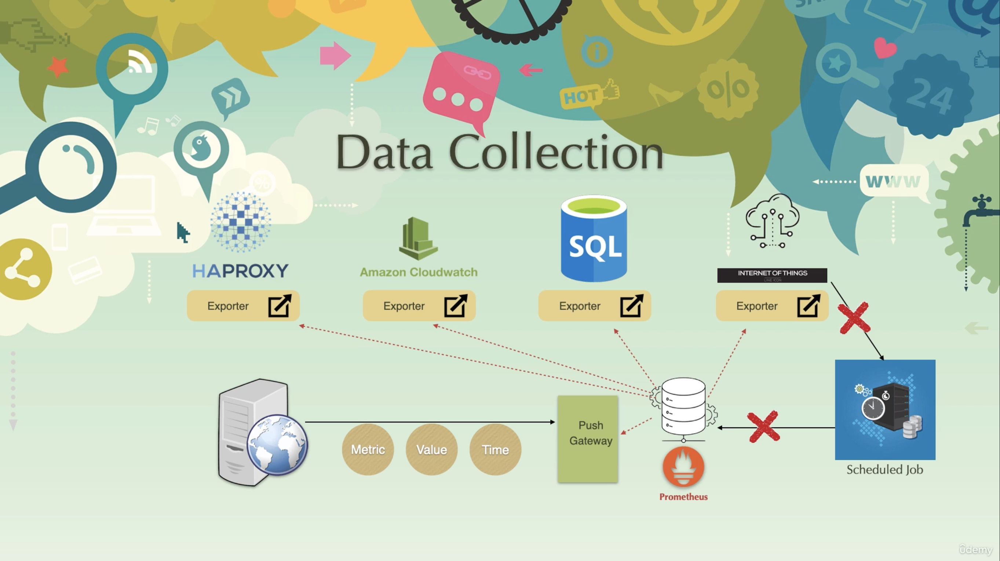

# 002 — Prometheus

## Table of Contents

1. [Installing Prometheus on Ubuntu](#1-installing-prometheus-on-ubuntu)
2. [Collecting Metrics](#2-collecting-metrics)
3. [Node Exporter](#3-node-exporter)
4. [Hands-on: Monitoring an App Server with Node Exporter](#4-hands-on-monitoring-an-app-server-with-node-exporter)
5. [Data Model](#5-data-model)
6. [PromQL Data Types](#6-promql-data-types)
7. [Arithmetic Operators](#7-arithmetic-operators)
8. [Comparison Operators](#8-comparison-operators)
9. [Set Operators](#9-set-operators)
10. [Label Selectors](#10-label-selectors)
11. [Aggregation Operators](#11-aggregation-operators)
12. [Time Offset](#12-time-offset)
13. [PromQL Functions](#13-promql-functions)
14. [Aggregation Over Time](#14-aggregation-over-time)

---

## 1. Installing Prometheus on Ubuntu

Steps to install **Prometheus v3.x** on a Linux (Ubuntu) server as a *systemd* service.

### Step 1 — Preparation & System Update

Check the processor architecture so you download the right release file.

```bash
# x86_64 = amd64, aarch64 = arm64
uname -m

sudo apt update && sudo apt upgrade -y
sudo apt install wget -y
```

### Step 2 — Create User & Directories

Create a *service account* without login access, plus data and config directories.

```bash
sudo groupadd --system prometheus
sudo useradd -s /sbin/nologin --system -g prometheus prometheus

sudo mkdir -p /var/lib/prometheus
sudo mkdir -p /etc/prometheus/rules
sudo mkdir -p /etc/prometheus/rules.d
sudo mkdir -p /etc/prometheus/files_sd
```

### Step 3 — Download, Extract, and Move the Binaries

```bash
wget https://github.com/prometheus/prometheus/releases/download/v3.16.0/prometheus-3.16.0.linux-amd64.tar.gz
tar xvf prometheus-3.16.0.linux-amd64.tar.gz
cd prometheus-3.16.0.linux-amd64

# Move binaries into the system PATH
sudo mv prometheus promtool /usr/local/bin/

# Copy the main config
sudo cp prometheus.yml /etc/prometheus/

# Verify
prometheus --version
```

### Step 4 — Set Ownership & Permissions

```bash
sudo chown -R prometheus:prometheus /etc/prometheus
sudo chmod -R 775 /etc/prometheus
sudo chown -R prometheus:prometheus /var/lib/prometheus
```

### Step 5 — Configure the Systemd Service

So Prometheus runs in the *background* and starts automatically on *reboot*.

```bash
sudo nano /etc/systemd/system/prometheus.service
```

```ini
[Unit]
Description=Prometheus
Documentation=https://prometheus.io/docs/introduction/overview/
Wants=network-online.target
After=network-online.target

[Service]
Type=simple
User=prometheus
Group=prometheus
ExecReload=/bin/kill -HUP $MAINPID
ExecStart=/usr/local/bin/prometheus \
  --config.file=/etc/prometheus/prometheus.yml \
  --storage.tsdb.path=/var/lib/prometheus/ \
  --web.listen-address=0.0.0.0:9090 \
  --web.external-url=

SyslogIdentifier=prometheus
Restart=always

[Install]
WantedBy=multi-user.target
```

Save with `Ctrl + O` → `Enter`, exit with `Ctrl + X`.

> **Prometheus 3.x note:** The `--web.console.templates` and `--web.console.libraries` flags are no longer used because the web console assets are embedded in the binary.

### Step 6 — Start & Verify

```bash
sudo systemctl daemon-reload
sudo systemctl enable --now prometheus
sudo systemctl status prometheus
```

### Step 7 — Open the Web UI

Once the status is **`active (running)`**, open:

```text
http://<SERVER_IP>:9090
```

> Make sure port **9090/TCP** is allowed in both the firewall (UFW) and your cloud provider's Security Group.

---

## 2. Collecting Metrics



Once Prometheus is installed, there are **3 main scenarios** for bringing metrics in.

### Scenario 1 — You Have the Application's Source Code → *Client Library*

- **Description:** For applications you build yourself (Python, Go, Java, Ruby, .NET), add the **official Prometheus library** to the code. It exposes a `/metrics` endpoint for scraping.
- **Analogy — A car you assembled yourself:** Since you built it, you're free to install temperature and speed sensors directly in the engine.

### Scenario 2 — No Source Code → *Exporter*

- **Problem:** Third-party systems whose code you can't change, for example:
  - Databases: **MySQL**, **PostgreSQL**
  - Load balancers: **HAProxy**
  - Cloud: **AWS CloudWatch**
  - Operating systems: **Linux / Windows Server**
  - **IoT** devices (traffic light sensors, temperature sensors)
- **The bad way:** Manual scripts (Bash/PowerShell + Cron Job) that push data to Prometheus. It doesn't scale, and if millions of IoT devices push at once, Prometheus can go *down*.
- **The solution — Exporter:**
  - A small program installed next to the target system that reads its state and **translates it into the Prometheus format**.
  - By default, Prometheus scrapes exporters **every 15 seconds**.
- **Analogy — A language interpreter:** Prometheus only understands Indonesian, MySQL only speaks Japanese. You hire an **interpreter (exporter)** to sit beside MySQL. Every 15 seconds Prometheus asks *"How is MySQL doing?"*, and the interpreter answers in Indonesian.

### Scenario 3 — Short-Lived Applications → *Pushgateway*

- **Problem:** Prometheus is **always Pull** and does not accept Push directly. What about *batch jobs* or *serverless* functions that live only 3 seconds?
- **Solution — Pushgateway:** An official Prometheus component that acts as a **temporary holding place**.
  1. The short-lived application pushes its metrics to Pushgateway before it dies.
  2. Prometheus still scrapes Pushgateway every 15 seconds as usual.
- **Analogy — A parcel drop box:** The express courier leaves the parcel in the box at the front gate and leaves. When the owner comes home, they simply pick it up from the box.

> **Important:** Pushgateway does **not** turn Prometheus into a Push system. Prometheus still pulls, just from Pushgateway.

### Summary

| Situation | Use |
|---|---|
| You have the application's code | **Client Library** |
| Third-party system / server / database | **Exporter** |
| A short-lived app that dies right after finishing | **Pushgateway** |

---

## 3. Node Exporter

### What is Node Exporter?

- **Not Node.js** — it has nothing to do with JavaScript.
- **"Node"** in Prometheus means a machine/server running a Unix-based kernel (Linux, Ubuntu).
- **Definition:** The *official exporter* from the Prometheus team that collects **system-level (kernel-level) metrics** from Unix/Linux machines.

### Metrics Collected (Default)

1. **CPU Usage** — how busy the processor is
2. **Memory Usage** — RAM usage
3. **Disk Usage** — storage capacity
4. **Network I/O** — network traffic

Can be extended with **pluggable metric collectors**.

### Analogy — An athlete's medical monitor

- **Server** = an athlete's body.
- **Node Exporter** = a medical monitor attached to the body, constantly reading heart rate, temperature, and blood pressure.
- **Prometheus** = the doctor who comes every 15 seconds to read that monitor's report.

---

## 4. Hands-on: Monitoring an App Server with Node Exporter

### Topology

| Role | IP | Port |
|---|---|---|
| Prometheus Server | `10.30.0.119` | `9090` |
| App Server (target) | `10.30.0.120` | `9100` |

### Step 1 — Install Node Exporter on the App Server (`10.30.0.120`)

1. **Create a system user:**

   ```bash
   sudo groupadd --system node_exporter
   sudo useradd -s /sbin/nologin --system -g node_exporter node_exporter
   ```

2. **Download and extract:**

   ```bash
   wget https://github.com/prometheus/node_exporter/releases/download/v1.12.1/node_exporter-1.12.1.linux-amd64.tar.gz
   tar xvf node_exporter-1.12.1.linux-amd64.tar.gz
   cd node_exporter-1.12.1.linux-amd64
   ```

3. **Move the binary & verify:**

   ```bash
   sudo mv node_exporter /usr/local/bin/
   node_exporter --version
   ```

### Step 2 — Secure Access (Prometheus Only)

*Bind* Node Exporter to the App Server's private IP and restrict it with a firewall.

1. **Create the service file:**

   ```bash
   sudo nano /etc/systemd/system/node_exporter.service
   ```

2. **Fill in the config** (replace `10.30.0.120` with the App Server's private IP):

   ```ini
   [Unit]
   Description=Node Exporter
   After=network.target

   [Service]
   User=node_exporter
   Group=node_exporter
   Type=simple
   ExecStart=/usr/local/bin/node_exporter \
     --web.listen-address=10.30.0.120:9100

   [Install]
   WantedBy=multi-user.target
   ```

3. **Start the service:**

   ```bash
   sudo systemctl daemon-reload
   sudo systemctl enable --now node_exporter
   sudo systemctl status node_exporter
   ```

4. **(Optional) Restrict with UFW** so port `9100` is only reachable by Prometheus:

   ```bash
   sudo ufw allow from 10.30.0.119 to any port 9100 proto tcp
   ```

### Step 3 — Register the App Server in Prometheus (`10.30.0.119`)

1. **Open the config:**

   ```bash
   sudo nano /etc/prometheus/prometheus.yml
   ```

2. **Add a scrape job:**

   ```yaml
   scrape_configs:
     # ... default prometheus job

     - job_name: 'app-server'
       static_configs:
         - targets: ['10.30.0.120:9100']
   ```

3. **Validate & restart:**

   ```bash
   promtool check config /etc/prometheus/prometheus.yml
   sudo systemctl restart prometheus
   ```

### Step 4 — Verify in the Web UI

1. Open `http://10.30.0.119:9090`.
2. Click **Status → Targets**.
3. Make sure the `app-server` target (`10.30.0.120:9100`) shows **UP** (green).

---

## 5. Data Model

- **Time series:** Every metric is stored together with a *timestamp* (Unix time).
- **Unique identity:** Each time series is identified by its **metric name + set of labels**.
- **Labels:** Optional *key-value* pairs, written in curly braces and separated by commas.

```promql
<metric_name>{<label_key>="<label_value>", ...}
```

**Example:**

```promql
auth_api_hit{count="1", time_taken="800"}
```

- `auth_api_hit` — the metric name (authentication API hits)
- `count`, `time_taken` — labels (`time_taken` is in milliseconds)

---

## 6. PromQL Data Types

### A. Scalar

A single value with no time series.

- **Float:** Both integers (`1`) and decimals (`1.5`) are treated as *float*.
- **String:** Text in quotes (`"..."` or `'...'`).

> **Example:** In `code="200"`, the value `200` is a **string**. That's why you can use regex such as `code=~"2.*"`. Writing `code=200` without quotes won't work.

### B. Instant Vector

A set of time series that each have **one latest sample**.

```promql
node_network_transmit_errs_total
node_network_transmit_errs_total{device="eth0"}
```

Result: one latest value for each unique label combination.

### C. Range Vector

Like an instant vector, but pulls **a range of historical samples**, marked with square brackets `[...]`.

```promql
node_network_transmit_errs_total[5m]
```

Meaning: data from the last 5 minutes. The number of samples depends on the duration and the *scrape interval* (default 15 seconds → about 20 samples per 5 minutes).

**Time units** (*case-sensitive*):

| Unit | Meaning |
|---|---|
| `ms` | milliseconds |
| `s` | seconds |
| `m` | minutes |
| `h` | hours |
| `d` | days (24 hours) |
| `w` | weeks (7 days) |
| `y` | years (365 days) |

> There is no unit for months.

---

## 7. Arithmetic Operators

| Operator | Meaning |
|---|---|
| `+` | Addition |
| `-` | Subtraction |
| `*` | Multiplication |
| `/` | Division |
| `%` | Modulo (remainder) |
| `^` | Power |

The result is always a **new vector/value**; the original data in Prometheus is unchanged.

### Application Rules

| Combination | Behavior | Example |
|---|---|---|
| Scalar ⊕ Scalar | Produces a new scalar | `2 + 2` → `4` |
| Vector ⊕ Scalar | The scalar is applied to **every** element of the vector | `550` and `333` minus `10` → `540` and `323` |
| Vector ⊕ Vector | Elements are matched by **exactly the same label set**; those without a match are dropped | See the illustration below |

> In vector-to-vector arithmetic, the **metric name is ignored** during matching and the result carries no metric name. What must be equal is the label set.

### Vector + Vector Illustration

**Vector A** — `api_errors_total`:

| Labels | Value |
|---|---|
| `{endpoint="/login"}` | 10 |
| `{endpoint="/register"}` | 5 |
| `{endpoint="/checkout"}` | 2 |

**Vector B** — `api_retries_total`:

| Labels | Value |
|---|---|
| `{endpoint="/login"}` | 3 |
| `{endpoint="/register"}` | 1 |

**Result of `A + B`:**

| Labels | Calculation | Result |
|---|---|---|
| `/login` | 10 + 3 | **13** ✅ |
| `/register` | 5 + 1 | **6** ✅ |
| `/checkout` | no match | **dropped** ❌ |

**Takeaway:** Only elements that have a **match** (labels line up) are processed; the "single" ones are dropped.

---

## 8. Comparison Operators

### Boolean Values

Prometheus uses numbers: **`1` = True**, **`0` = False**.

### Operators

| Operator | Meaning |
|---|---|
| `==` | Equal |
| `!=` | Not equal |
| `>` | Greater than |
| `<` | Less than |
| `>=` | Greater than or equal |
| `<=` | Less than or equal |

### How It Works

| Combination | Behavior | Example |
|---|---|---|
| Scalar vs Scalar | Result is `1` or `0` (requires `bool`) | `5 == bool 5` → `1` |
| Vector vs Scalar | **Filter**: only elements meeting the condition appear | Vector with `10` and `4`, query `== 10` → only `10` |
| Vector vs Vector | Match pairs with the same labels, then filter those meeting the condition | — |

> Add the `bool` modifier (e.g. `metric > bool 5`) if you want `0`/`1` results instead of filtering.

---

## 9. Set Operators

### General Rules

- **Instant vectors only** (not scalars or range vectors).
- **Lowercase:** `and`, `or`, `unless`.

### The Three Operators

| Operator | Name | Result |
|---|---|---|
| `and` | Intersection | Left elements that **have a matching label set** on the right (values taken from the left) |
| `or` | Union | All left elements, plus right elements whose labels are not on the left |
| `unless` | Difference | Left elements that **have no matching label set** on the right |

> Matching is based on the **label set**, not the values.

---

## 10. Label Selectors

### Basics

- A query starts with the metric name, then is narrowed with label filters inside `{}`.
- **Comma (`,`) = AND:** all filters must be satisfied together.

### Operators

| Operator | Meaning |
|---|---|
| `=` | Exactly equal |
| `!=` | Not equal |
| `=~` | Matches regex |
| `!~` | Does not match regex |

```promql
prometheus_http_requests_total{code=~"2.*", handler!="/metrics"}
```

### Important Notes

- **Regex:** `.*` matches any characters (e.g. `2.*` = starts with 2). Avoid regexes that can match an empty string.
- **Data type:** Label values are always **strings**. Writing `1000` without quotes (instead of `"1000"`) errors because there is no implicit conversion.

---

## 11. Aggregation Operators

### Basics

- Summarizes the elements of an **instant vector** into a new vector with fewer elements.
- Syntax resembles a function: `operator(instant_vector)`.

### Operators

| Operator | Function |
|---|---|
| `sum` | Total sum |
| `min` | Smallest value |
| `max` | Largest value |
| `avg` | Average |
| `count` | Number of elements |
| `group` | Groups elements; the result value is always `1` |
| `count_values` | Number of elements per given value |
| `topk(n, v)` | The *n* elements with the **largest** values |
| `bottomk(n, v)` | The *n* elements with the **smallest** values |
| `stddev` | Population standard deviation |
| `stdvar` | Population variance |

### The `by` and `without` Modifiers

- **`by (label)`** — group **only** by the labels named.

  ```promql
  sum(node_cpu_seconds_total) by (mode)
  ```

- **`without (label)`** — drop the labels named, keep the rest.

  ```promql
  sum(node_cpu_seconds_total) without (mode)
  ```

---

## 12. Time Offset

### Basics

- By default, an instant vector takes the **latest** value.
- **`offset`** pulls data from a point in the past, using standard duration units (`ms`, `s`, `m`, `h`, `d`, `w`, `y`).

```promql
prometheus_http_requests_total offset 10m
```

### Placement of `offset`

`offset` **must be placed right after the metric selector**, not at the end of the query.

✅ **Correct:**

```promql
avg(prometheus_http_requests_total offset 8h) by (code)
```

❌ **Wrong:**

```promql
avg(prometheus_http_requests_total) by (code) offset 8h
```

---

## 13. PromQL Functions

### A. Data Availability

Useful for *alerting* when a metric disappears.

| Function | Input | Behavior |
|---|---|---|
| `absent(v)` | Instant vector | Data exists → **empty** result. No data → a 1-element vector with value **`1`** |
| `absent_over_time(v[d])` | Range vector | Same as `absent`, over a time range |

### B. Basic Math

| Function | Meaning | Example |
|---|---|---|
| `abs()` | Absolute value | `-5` → `5` |
| `ceil()` | Round up | `1.6` → `2` |
| `floor()` | Round down | `1.6` → `1` |

### C. Clamping

Useful for tidying dashboard graphs (e.g. Grafana).

| Function | Meaning |
|---|---|
| `clamp_min(v, min)` | Values below `min` are raised to `min` |
| `clamp_max(v, max)` | Values above `max` are lowered to `max` |
| `clamp(v, min, max)` | Lower and upper bound at once |

### D. Calendar

Extracts day information from a timestamp (UTC):

| Function | Result |
|---|---|
| `day_of_month()` | `1`–`31` |
| `day_of_week()` | `0`–`6`, where **`0` = Sunday**, `1` = Monday, ..., `6` = Saturday |

### E. Value Change

> Only for **gauges** (values that go up and down, e.g. temperature, memory), **not counters**.

| Function | Meaning |
|---|---|
| `delta(v[d])` | Difference between the first and last value in the range |
| `idelta(v[d])` | Difference between the **last two samples** in the range |

```promql
delta(node_cpu_temperature[2h])
```

### F. Logarithms

| Function | Base | Example |
|---|---|---|
| `log2(v)` | 2 | `2` → `1` |
| `log10(v)` | 10 | `10` → `1` |
| `ln(v)` | *e* (natural) | `e` → `1` |

### G. Sorting

| Function | Order |
|---|---|
| `sort(v)` | Ascending (small → large) |
| `sort_desc(v)` | Descending (large → small) |

### H. Time & Timestamp

| Function | Result |
|---|---|
| `time()` | Current Unix timestamp (seconds), as a scalar |
| `timestamp(v)` | Timestamp of when the sample was scraped. Combined with `offset`, the timestamp shifts into the past too |

---

## 14. Aggregation Over Time

### Basics

- Regular aggregation operators (`sum`, `avg`, etc.) only work on **instant vectors**; using a range vector (`[2h]`) errors.
- For range vectors, use the functions ending in **`_over_time`**, which summarize historical samples **per time series**.

### Functions

| Function | Result over the time range |
|---|---|
| `avg_over_time(v[d])` | Average |
| `sum_over_time(v[d])` | Total |
| `min_over_time(v[d])` | Smallest value |
| `max_over_time(v[d])` | Largest value |
| `count_over_time(v[d])` | Number of samples |
| `stddev_over_time(v[d])` | Standard deviation |
| `stdvar_over_time(v[d])` | Variance |

```promql
avg_over_time(node_load1[1h])
```
